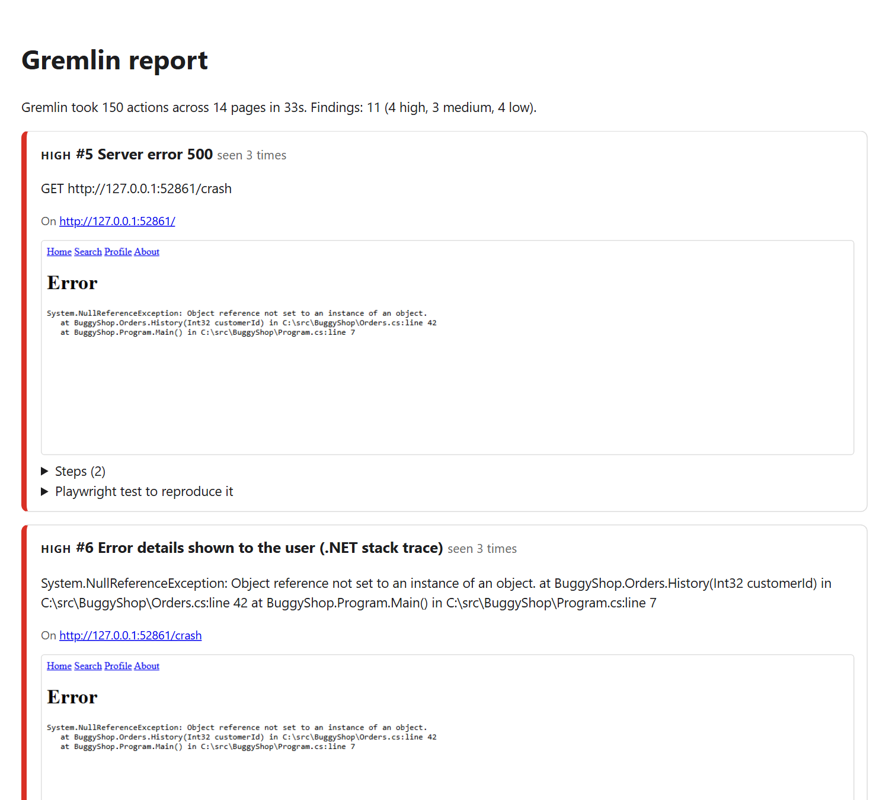
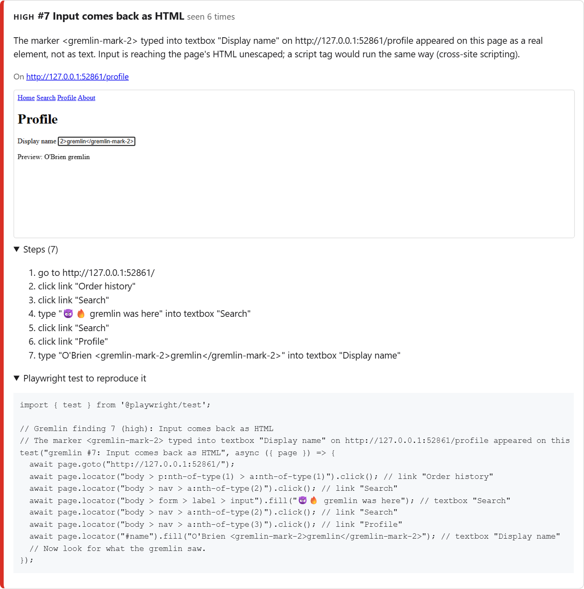

# Gremlin

[](https://github.com/gillersja1/Gremlin/actions/workflows/ci.yml)

Turn a gremlin loose on your web app. It explores with [Playwright](https://playwright.dev) like a curious,
slightly malicious user: following links, typing odd things into fields, ticking boxes and picking options.
Then it tells you what broke. Every finding comes with the steps that led to it, a screenshot, a full
Playwright trace, and a ready-to-run Playwright test that reproduces it.

> **Only point Gremlin at sites you own or have written permission to test.** It behaves like an attacker
> poking at forms. It refuses anything other than localhost unless you pass `--authorized`.

## What it finds

| Severity | Finding |
| --- | --- |
| High | **Input comes back as HTML**: text it typed reappears as real markup (a sign of cross-site scripting) |
| High | **Server errors** (HTTP 5xx) |
| High | **Error details shown to users**: stack traces, SQL errors, PHP warnings |
| Medium | Uncaught JavaScript errors, broken links (404/410), failed requests, insecure content on https pages, unprotected session cookies |
| Low | Errors logged to the console, missing security headers (CSP, nosniff, anti-framing, HSTS), pages that scroll sideways |

It finds the warning signs without exploiting them. The only HTML it types is a harmless made-up tag,
`<gremlin-mark-N>`: if that comes back as a real element, input is reaching the page unescaped, and a
`<script>` would too. Everything else is what real users type by accident: apostrophes, emoji, very long
text, odd numbers and dates.

## What you get

A run against the deliberately buggy site in this repo's tests: 150 actions in 33 seconds, 11 findings.



Each finding opens up into the steps that led to it and a Playwright test that replays them:



## Quick start

```bash
npm install
npx playwright install chromium
npx tsx src/cli.ts http://localhost:3000
```

Open `gremlin-report/report.html` for the findings. Each has a test in `gremlin-report/repro/`, and the
whole run is in `gremlin-report/trace.zip` (`npx playwright show-trace gremlin-report/trace.zip`).

## Guardrails

- **Stays on your site.** It only visits the start URL's host, plus any you add with `--allow`.
  Everything else is skipped, including downloads.
- **Careful by default.** It won't submit forms or press Enter in fields unless you pass `--submit-forms`,
  because submitting can create or change data. Point it at a local or staging copy when you do.
- **Leaves destructive controls alone.** It won't click anything labelled delete, remove, pay, buy,
  checkout, log out, unsubscribe, reset and the like, unless you pass `--unsafe`.
- **Dismisses dialogs** so an `alert()` can't stall it.
- **Repeatable.** Runs are seeded; the report gives the seed, and `--seed` replays the same choices.

## Options

```text
gremlin <url> [options]
gremlin save-session <url> [--to <file>]   (default file: gremlin-session.json)

  --actions <n>      How many things to try (default: 200)
  --minutes <n>      Stop after this long, whichever comes first (default: 5)
  --seed <n>         Repeat a run exactly
  --allow <host>     Another host it may visit (repeatable)
  --submit-forms     Submit forms and press Enter in fields
  --unsafe           Also click destructive-looking controls
  --avoid <text>     Also leave alone anything whose label contains this (repeatable)
  --mobile           Explore on a phone-sized screen
  --headed           Watch it in a visible browser
  --session <file>   Start signed in, from a session saved with save-session
  --login <script>   Start signed in by running a login script first
  --out <dir>        Where to write the report (default: gremlin-report)
  --fail-on <level>  Exit 1 if anything this severe is found: high, medium, low or never (default: high)
  --authorized       Required for anything other than localhost
```

`--fail-on` makes it a CI check: run your app, release the gremlin, and fail the build on high findings.

## Exploring signed in

Most bugs live behind the sign-in page. There are two ways to let the gremlin in.

**Sign in by hand, once.** This works with any sign-in, including GitHub, Google and two-factor:

```bash
npx tsx src/cli.ts save-session https://staging.example.com/login
# sign in in the browser that opens, then press Enter in the terminal (or close the browser)
npx tsx src/cli.ts https://staging.example.com/ --authorized --session gremlin-session.json
```

**Or with a script**, for a plain username and password form (handy in CI, where nobody can type):

```js
// login.mjs
export default async page => {
  await page.goto('http://localhost:3000/login');
  await page.getByLabel('Email').fill(process.env.TEST_USER);
  await page.getByLabel('Password').fill(process.env.TEST_PASSWORD);
  await page.getByRole('button', { name: 'Sign in' }).click();
  await page.waitForURL('**/dashboard');
};
```

```bash
npx tsx src/cli.ts http://localhost:3000/dashboard --login login.mjs
```

While it explores, the gremlin watches the session's cookies. If they disappear (an expired session, or a
sign-out link it was allowed to click with `--unsafe`), it says after which action, so you know which
pages it saw signed out. The repro tests start from the same saved session.

Signed in, a click can change real data, and not every button that saves says "delete" or "pay". Many save
through JavaScript rather than a form, so `--submit-forms` being off doesn't stop them. Add the labels of
anything that would change your account with `--avoid`, e.g. `--avoid leaderboard --avoid certificate`.

`save-session` keeps only the cookies of the site you signed in to. Signing in through GitHub or Google
also leaves that provider's cookies, which are a login to your account there, and the gremlin doesn't
need them.

Use a test account. A saved session works like a password, and so do the trace and screenshots from a
signed-in run, so keep them out of git and don't share them. `gremlin-session*.json` is already in
`.gitignore`. The login script runs before tracing starts, so what it types isn't recorded.

## First catch

Its first outing outside the test suite was against [Playwright Dungeon Crawl](https://github.com/gillersja1/PlaywrightDungeonCrawl-Starter),
running locally: 250 actions over 40 pages, forms included, with no injections, crashes or leaks. It did
find that the dungeon sent no Content-Security-Policy, X-Content-Type-Options or anti-framing headers. The
dungeon now sends all three (with a nonce-based CSP), and the same run, same seed, comes back with zero
findings.

## Development

```bash
npm test          # unit tests, plus a full run against a deliberately buggy local site
npm run typecheck
npm run build     # compiles the CLI to dist/
```

The buggy site in `test/fixtures/` has one of each problem planted on purpose, and a "Delete everything"
link the gremlin must never follow.

## License

MIT
